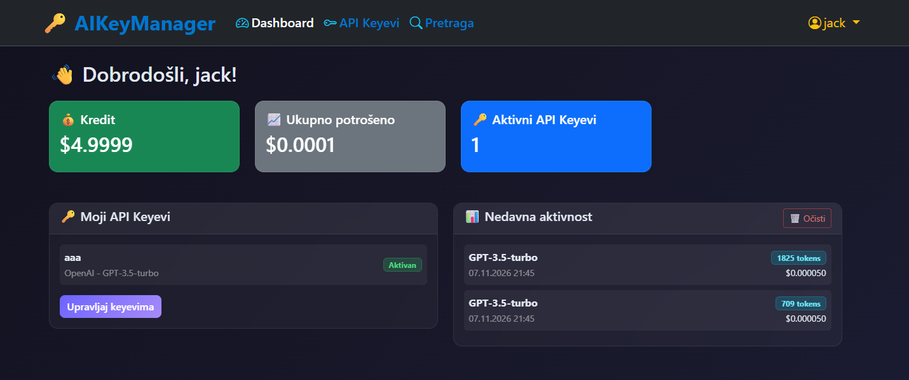
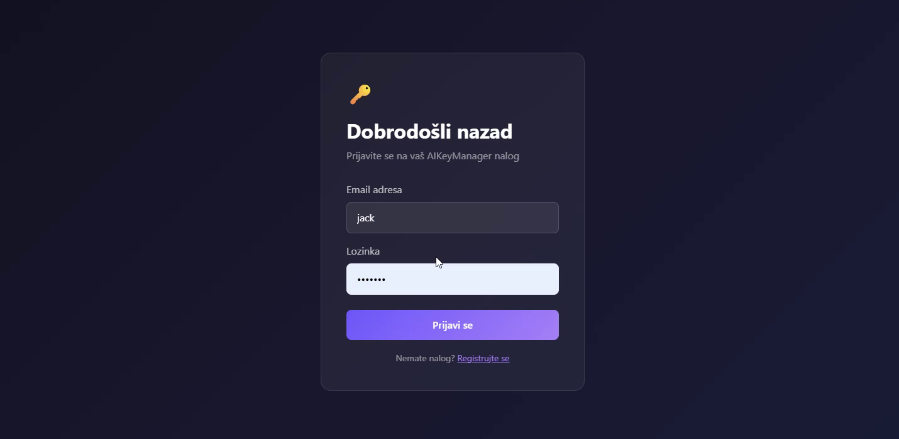
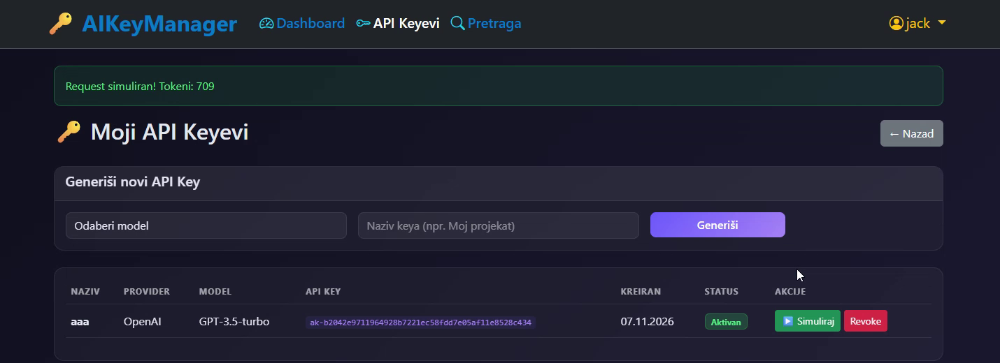
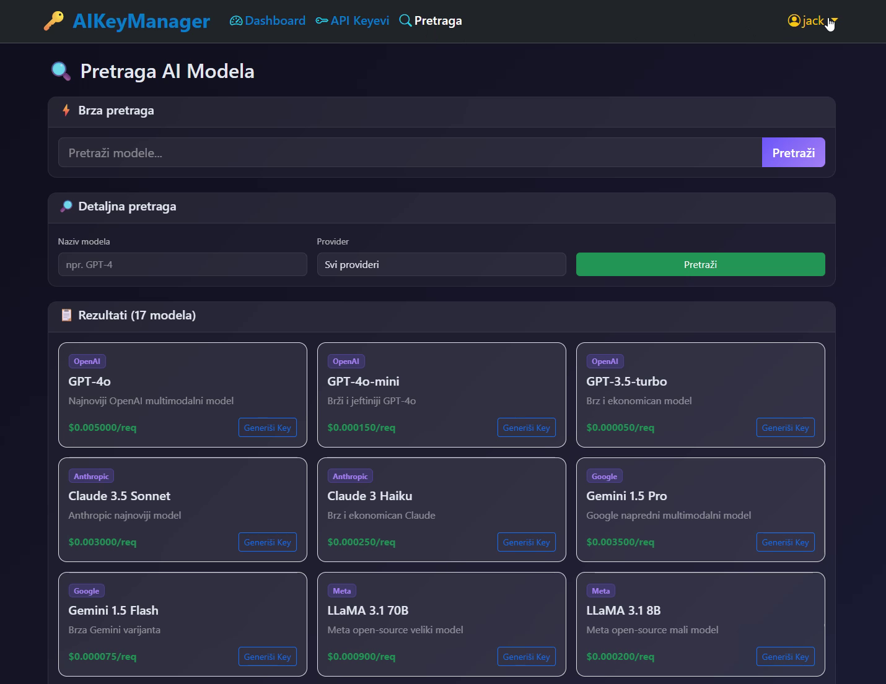

# AIKeyManager

A web platform that simulates managing API keys for AI models. Users browse a catalog of models from several providers, generate API keys, simulate requests against them and watch their credit and usage update in real time. Built with ASP.NET Core MVC and SQL Server, with a lot of the logic living in the database itself.

> This is a simulation. No real requests are made to any AI provider.



## Features

- **Registration and login** with cookie authentication and role-based access (admin and user)
- **Dashboard** with the user's credit balance, total amount spent, number of active keys and a feed of recent activity (model, tokens used, cost)
- **API key management**: generate a key for a chosen model, give it a name, simulate a request with it or revoke it
- **Usage tracking**: every simulated request records tokens and cost and deducts it from the user's credit (new accounts start with $5.00)
- **Model search** with quick search and detailed search by model name and provider
- **Model catalog** with per-request pricing across OpenAI, Anthropic, Google and Meta models
- **Database logic in SQL Server**: triggers, stored procedures, and scalar and table-valued functions

The interface is in Montenegrin.

## Screenshots

| Login | API keys |
|---|---|
|  |  |



## Tech stack

| Layer | Technologies |
|---|---|
| Web framework | ASP.NET Core MVC (C#) |
| Data access | Entity Framework Core |
| Database | SQL Server (schema, triggers, stored procedures, functions) |
| Authentication | Cookie authentication, role-based authorization |
| Frontend | Razor views, Bootstrap |

Built as a project for the Advanced Databases course at the Faculty of Natural Sciences and Mathematics, University of Montenegro. It was my first project in C# and .NET.

## Getting started

### Prerequisites

- Visual Studio 2022 with the ASP.NET and web development workload
- .NET SDK matching the version in `AIKeyManager.csproj`
- SQL Server (LocalDB or Express is enough)

### 1. Clone the repository

```bash
git clone https://github.com/ogi122/AIKeyManager.git
```

### 2. Configure the database connection

Copy `appsettings.example.json` to `appsettings.json` and set your connection string:

```json
{
  "ConnectionStrings": {
    "DefaultConnection": "Server=(localdb)\\MSSQLLocalDB;Database=AIKeyManager;Trusted_Connection=True;"
  }
}
```

### 3. Create the database

Open **Tools → NuGet Package Manager → Package Manager Console** in Visual Studio and run:

```powershell
Update-Database
```

### 4. Run the project

Open `AIKeyManager.slnx` in Visual Studio, set `AIKeyManager` as the startup project and press **F5**.
