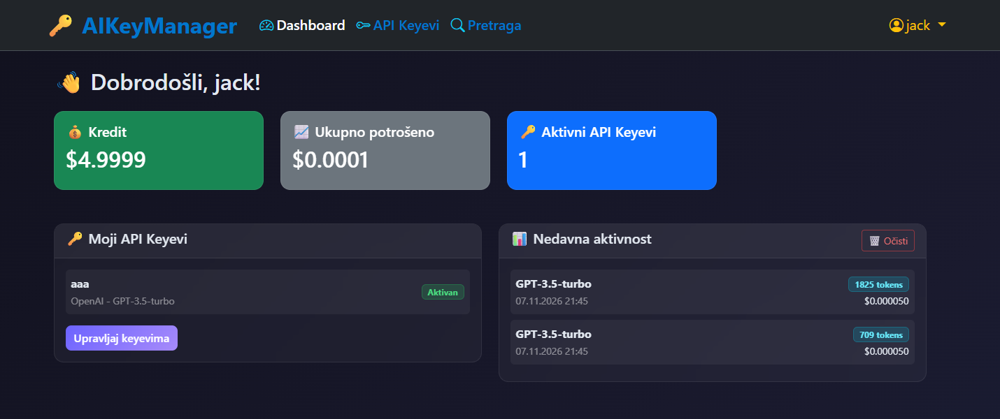
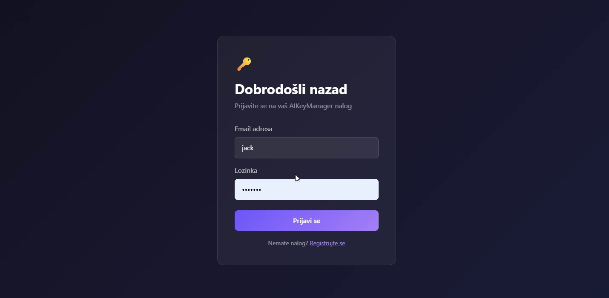
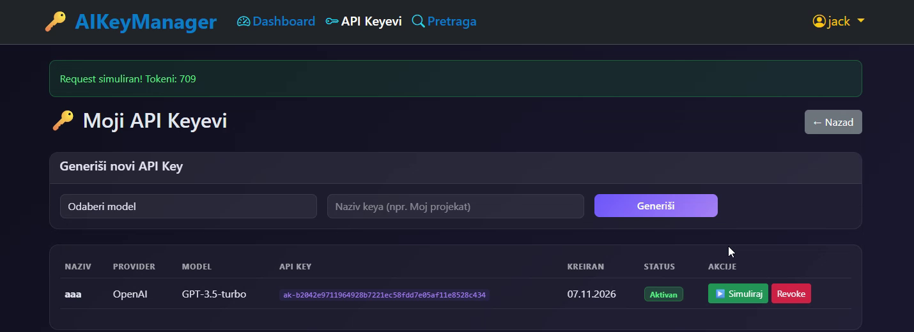
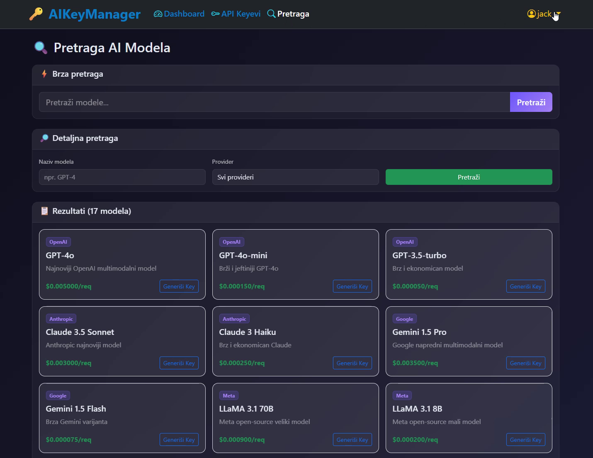

# AIKeyManager

A web platform that simulates managing API keys for AI models. Users browse a catalog of models from several providers, generate API keys, simulate requests against them and watch their credit and usage update in real time. Built with ASP.NET Core MVC and SQL Server, with a lot of the logic living in the database itself.

> This is a simulation. No real requests are made to any AI provider.



## Features

- **Registration and login** with cookie authentication and role-based access (admin and user)
- **Dashboard** with the user's credit balance, total amount spent, number of active keys and a feed of recent activity (model, tokens used, cost)
- **API key management**: generate a key for a chosen model, give it a name, simulate a request with it or revoke it
- **Usage tracking**: every simulated request records tokens and cost and deducts it from the user's credit (new accounts start with $5.00)
- **Model search** with quick search and detailed search by model name and provider
- **Model catalog** with per-request pricing across OpenAI, Anthropic, Google and Meta models
- **Database logic in SQL Server**: triggers, stored procedures, and scalar and table-valued functions

The interface is in Montenegrin.

## Screenshots

| Login | API keys |
|---|---|
|  |  |



## Tech stack

| Layer | Technologies |
|---|---|
| Web framework | ASP.NET Core MVC (C#) |
| Data access | Entity Framework Core |
| Database | SQL Server (schema, triggers, stored procedures, functions) |
| Authentication | Cookie authentication, role-based authorization |
| Frontend | Razor views, Bootstrap |

Built as a project for the Advanced Databases course at the Faculty of Natural Sciences and Mathematics, University of Montenegro. It was my first project in C# and .NET.

## Getting started

### Prerequisites

- Visual Studio 2022 (version 17.13 or newer, needed for the `.slnx` solution format) or Visual Studio 2026, with the **ASP.NET and web development** workload
- .NET SDK matching the version in `AIKeyManager.csproj`
- SQL Server Express (LocalDB also works, but you have to change the connection string, see step 2)
- SQL Server Management Studio (SSMS), or any other tool that can run a `.sql` script

### 1. Clone the repository

```bash
git clone https://github.com/ogi122/AIKeyManager.git
```

### 2. Check the database connection

The connection string is already included in `appsettings.json` and points to a local SQL Server Express instance:

```
Server=localhost\SQLEXPRESS;Database=AIKeyManager;Trusted_Connection=True;TrustServerCertificate=True;
```

If you use LocalDB or a different SQL Server instance, change the `Server=` part, for example:

```
Server=(localdb)\MSSQLLocalDB;Database=AIKeyManager;Trusted_Connection=True;TrustServerCertificate=True;
```

### 3. Create the database

The database (tables, triggers, stored procedures, functions and seed data) is created with a SQL script. This project does not use EF migrations, so `Update-Database` will **not** create the schema.

1. Open **SQL Server Management Studio** and connect to your SQL Server instance (for example `localhost\SQLEXPRESS`).
2. Open `AIKeyManager.sql` from the root of the repository (**File → Open → File**).
3. Press **F5** to run the script.

The script creates the `AIKeyManager` database and fills it with the model catalog, subscription plans and an admin account. It is meant to be run once on a clean database. If you want to run it again, delete the `AIKeyManager` database first.

### 4. Run the project

Open `AIKeyManager.slnx` in Visual Studio, set `AIKeyManager` as the startup project and press **F5**.

### 5. Log in

Use the default admin account:

| Username | Password |
|---|---|
| `admin` | `Admin123!` |

Or register a new user. New accounts start with $5.00 of credit.
